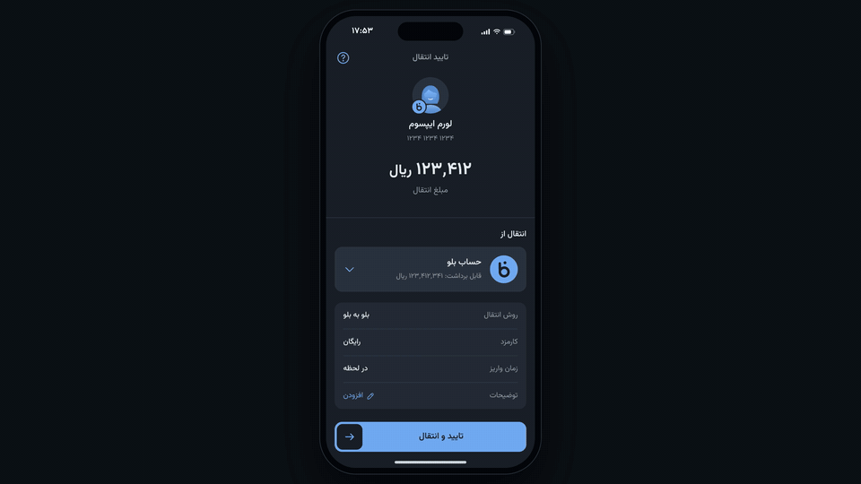
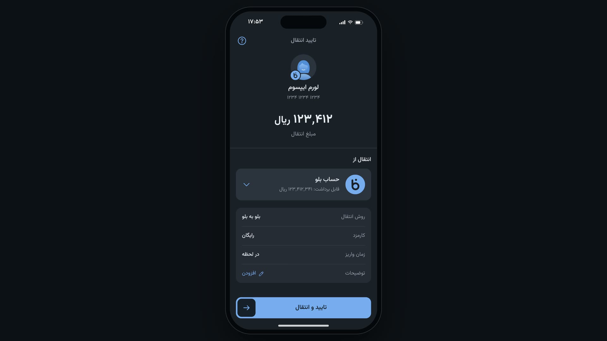

# Blue Payment — animation concept

A payment-confirm screen in a Persian (RTL) banking app style, built to show one moment well: **swipe to send**. As the thumb slides left → right the amount crumbles into dust; let go early and it re-forms. Swipe all the way and a status island scans, spins and checks while the dust streams into it, then the success screen counts the amount up digit by digit.

**Live:** https://blue-payment-animation-concept.vercel.app

<a href="https://blue-payment-animation-concept.vercel.app"></a>

▶️ Full-quality video (1920×1080, 60 fps, loops): [docs/demo.mp4](docs/demo.mp4)



## What moves

- **Swipe to send** — a drag control whose progress drives the dissolve. Release before the end and the thumb springs back while the dust re-forms the amount.
- **Text → dust** — the amount is sampled into ~1,000 particles on one `<canvas>`. Every particle's position is a pure function of three numbers (dissolve, float, converge), so any phase can run backwards cleanly.
- **Status island** — scan → spinner → check (or a cross on failure), springing between sizes; on return it drops a receipt with rolling digits.
- **Rolling numbers** — odometer digits with a short motion blur, settling one after another.
- **Failure path** — open the help sheet («؟») and turn on «شبیه‌سازی خطا»: the next transfer fails, the amount re-forms and «تلاش دوباره» retries.
- Keyboard: focus the swipe control and press Enter. Respects `prefers-reduced-motion`.

## Run it

```bash
npm install
npm run dev
```

## Record the videos

Filmed frame by frame on a virtual clock (no dropped frames); a soft touch dot plays the finger and the drags are real pointer events.

```bash
npm i --no-save puppeteer-core
npm run build
node tools/record.mjs social-4k.mp4 540 960 4    # 9:16, 2160×3840
node tools/record.mjs readme-4k.mp4 1280 720 3   # 16:9, 3840×2160
```

Needs Google Chrome and ffmpeg. `?demo` in the URL hides the footer for clean recordings.

## Stack

Vite · React 18 · TypeScript · Tailwind CSS v4 · Motion · Canvas 2D · Vazirmatn

- `src/screens/Flow.tsx` — confirm screen and the processing sequence
- `src/screens/Success.tsx` — result screen and details sheet
- `src/components/Particles.tsx` — text-to-dust engine
- `src/components/SwipeConfirm.tsx`, `Island.tsx`, `RollingNumber.tsx`

## Credits

A non-commercial design concept. The look is inspired by the blu banking app (blu and its «b» mark belong to their owners). Name and numbers are placeholders («لورم ایپسوم», 1234…). Nothing is sent anywhere — the transfer is simulated.

Design experiment by [Hamzeh](https://hamzeh.framer.ai/?utm_source=blue-payment-animation-concept&utm_medium=referral) · Built with Claude.
